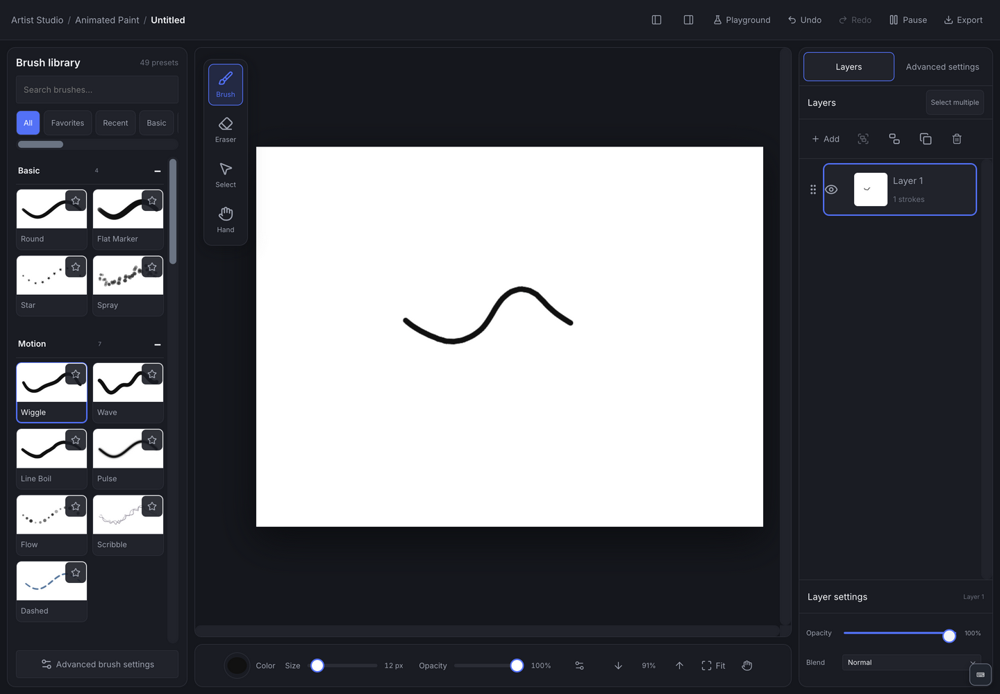
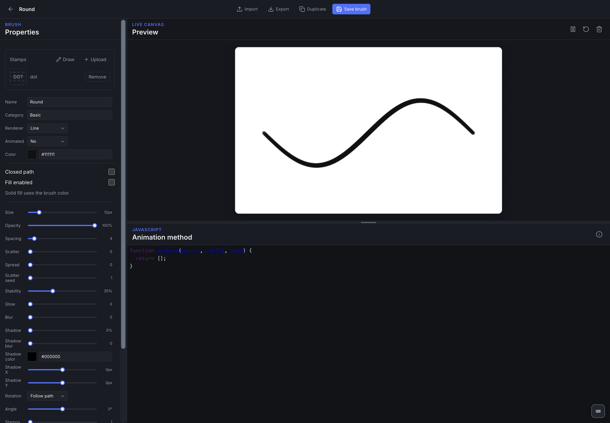

# Animated Paint

Paint with procedural brushes that move over time. Open the tool at `#/paint`; the brush library and playground are at `#/paint/playground`.



## First painting

1. Create a canvas and choose a built-in brush from the library.
2. Draw strokes, change size/color/opacity, and add layers to separate artwork.
3. Play the brush animation and adjust the selected recipe's settings.
4. Import an image layer if you want a backdrop; adjust its transform and ordering.
5. Open Export to render a GIF, PNG sequence, or video supported by the current browser.

Brushes include stamp, line, ribbon, and particle renderers with procedural motion, seeded variation, accents, weather, and expressive presets. The playground previews custom JavaScript recipes. Brush JSON is portable through import/export; duplicate a built-in recipe to experiment.



## Saving and security

Projects/assets/custom brushes use `/v1/apps/animated-paint` on the local Python API. Browser sessions need `npm run dev:api`; desktop starts it automatically. Copy the complete API directory for editable backups. Exported animation is flattened output. [Backups](../../docs/data-and-backups.md).

**Brush recipes execute JavaScript. Use trusted recipes.** The worker/global wrappers are not a security sandbox. See [security boundaries](../../SECURITY.md). Render performance depends on canvas size, stroke/particle count, and device capabilities; export support depends on codecs.

## Development

`web/paint/v2/core/` defines/validates formats; `animation/` evaluates recipes; `render/` handles surfaces, caches, workers, previews, and export; `input/` processes strokes/images; `playground/` edits brushes. `server/` stores projects and assets.

```sh
npx vitest run apps/animated-paint
npm run test:suite:browser
npm run build
```

[Gallery](../../docs/screenshots/animated-paint/home.png) · [Writing brush files](../../docs/writing-brush-files.md) · [Performance notes](../../docs/animated-paint-render-performance.md) · [Testing](../../docs/testing.md)
