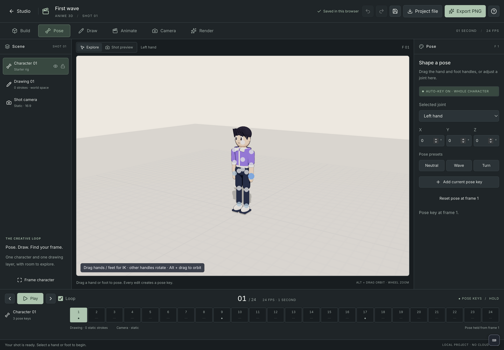

# Anime 3D




Anime 3D is a local creative tool inside Artist Studio. Open it from the tool launcher or at `#/anime-3d`.

## First shot

1. Choose **Try First wave** for a three-pose sample, or create a new shot.
2. In **Build**, place the character and change the jacket, background, or ground.
3. In **Pose**, drag a hand or foot for inverse kinematics. Select other joint handles or use the rotation fields. A change creates a whole-character pose key at the current frame.
4. In **Draw**, choose a front, side, top, or view-facing plane. Drag to draw; choose depth and brush width in world units. Strokes remain in the scene throughout the shot.
5. In **Animate**, move, copy, or delete pose keys. Each pose holds until the next key. Frame 1 is the protected base pose.
6. In **Camera**, orbit in Explore, then choose **Use this view for shot**. The saved shot camera is independent of Explore.
7. In **Render**, choose cel shading, outlines, light direction, ground, and background transparency. Export the current frame as a 1280 × 720 PNG.

Projects autosave to IndexedDB in the current browser profile. **Project file** downloads a portable `.anime-3d.json` copy; **Open project file** imports it as a new project. A failed save keeps the editor open and provides retry and download actions. No cloud sync is implemented.

## Controls

| Action | Control |
| --- | --- |
| Orbit | Alt + left drag |
| Pan | Right drag |
| Zoom | Wheel |
| Frame character | F |
| Play / pause | Space |
| Undo / redo | Ctrl/Cmd + Z / Shift + Z |
| Save locally | Ctrl/Cmd + S |
| Cancel a drawing or posing gesture | Escape |
| Step frames while timeline is focused | Left / right arrow |

## Current scope

This is the first working slice of the Anime 3D plan: one original procedural character, a 15-joint rig, one static world-space drawing layer, one static shot camera, and a fixed one-second shot (24 frames at 24 fps). Pose animation uses holds, with no interpolation. Undo retains the last 40 edits.

See [wireframes and implementation scope](design/wireframes-and-scope.txt) for the screen layouts, sample journeys, and differences from the broader product plan.

The character and environment designers, imported character rigs, surface-bound strokes, multiple characters, longer shots, camera animation, and video/sequence export are future work. The current exporter creates PNG stills. Transparent output preserves any visible ground; hide ground for a character cutout.

Project import validates the format before writing: version 1, an 8 MiB file limit, up to 200 strokes and 40,000 total points, finite coordinates, valid colors, and a frame-1 pose. Invalid imports do not replace existing projects.

## Development and verification

```sh
npm run dev:web
npx vitest run apps/anime-3d/web
npm run test:anime-3d:browser
npm run build
```

The Chromium smoke test uses Electron, an isolated temporary profile, and a Vite server on an ephemeral port. It verifies actual pointer drawing, pose holds, undo/redo, ordered saves, save failure recovery, camera capture, exported PNG pixels, and reopening an unchanged saved document.

## Structure

- `web/model.ts`: validated document model and pose/key operations.
- `web/library.ts`: isolated IndexedDB project storage.
- `web/rig.ts`: procedural character and two-bone IK.
- `web/AnimeViewport.tsx`: Three.js rendering, gestures, independent cameras, and PNG capture.
- `web/useProjectHistory.ts`: undo/redo, ordered autosaves, and navigation protection.
- `web/AnimeHome.tsx` / `web/AnimeEditor.tsx`: project library and six-stage editor.
- `tool.json`: Artist Studio tool registry entry.

## Suite guides

[Installation](../../docs/installation.md) · [Development](../../docs/development.md) · [Saving and backups](../../docs/data-and-backups.md) · [Testing evidence](../../docs/testing.md) · [Gallery screenshot](../../docs/screenshots/anime-3d/home.png)
