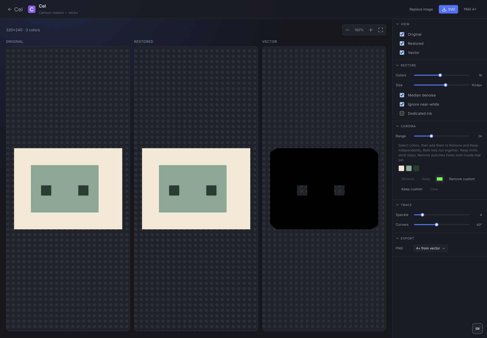

# Cel Restoration

Restore flat-color cartoon artwork and trace it into SVG. Open `#/cel` inside Artist Studio.



## First still

1. Create a named project and drop a PNG, JPEG, or WebP into the editor.
2. Adjust the restoration controls to clean flats and preserve outlines.
3. Review detected colors; remove/retain chroma colors or add custom choices.
4. Compare source/restored artwork, inspect the vector preview, and adjust tracing settings.
5. Download SVG or choose a PNG export scale.

This workflow targets limited palettes, hard outlines, and cel-shaded artwork. Photographs and gradients may become color bands. Output should be visually checked before replacing source artwork. This tool is deterministic restoration/vector tracing; it does not use a cloud generative model.

## Storage

Projects, settings, and source image assets use `/v1/apps/cel` on the Python API. Desktop starts it automatically. Browser sessions need `npm run dev:api`. Keep the source asset and full API directory when backing up; a settings document alone does not embed the original image. [Backup guide](../../docs/data-and-backups.md).

## Development

`web/restore.ts` performs raster cleanup; `trace.ts` and its worker/host perform tracing; `exportPng.ts` rasterizes output; `document.ts` defines settings; `projects/` talks to the local store. `CelStudio.tsx` and `CelHome.tsx` provide the workspace/gallery.

```sh
npx vitest run apps/cel
npm run test:suite:browser
npm run test:api
npm run build
```

[Gallery screenshot](../../docs/screenshots/cel/home.png) · [Development](../../docs/development.md) · [Testing](../../docs/testing.md)
