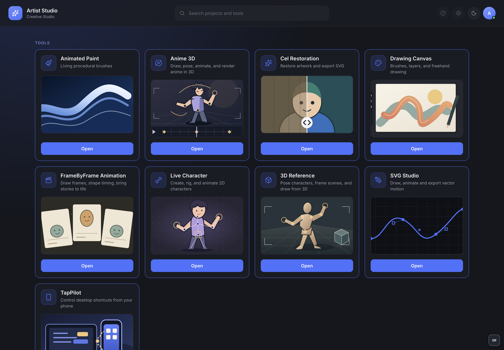

# Artist Studio desktop

The Electron host brings all nine tools into one local application. The home screen lists tools and recent projects, supports search and theme switching, and opens tools in separate windows. Reopening a tool focuses its existing window.

## Start and build

From the repository root, run `npm run setup` and `npm start`. Use `npm run package` for an unpacked app or `npm run dist` for current-platform installers. The host uses a development Python environment locally and the frozen backend in new distributions.

## Structure

- `electron/main.mjs`: windows, backend lifecycle, navigation/IPC trust boundary.
- `electron/preload.cjs`: narrow renderer APIs for Studio and TapPilot.
- `electron/paths.mjs`: development/packaged paths and legacy interpreter detection.
- `electron/security.cjs`: trusted URL, route, and external-link rules.
- `renderer/`: launcher, routes, themes, shortcut guide, recent-project integration.

On macOS, closing the last window keeps the application running. Dock activation reopens home; Quit stops the backend and TapPilot runtime. Other platforms quit on last-window close.

See [installation](../../docs/installation.md), [testing](../../docs/testing.md), [security](../../SECURITY.md), and [saving/backup](../../docs/data-and-backups.md) before distribution.
