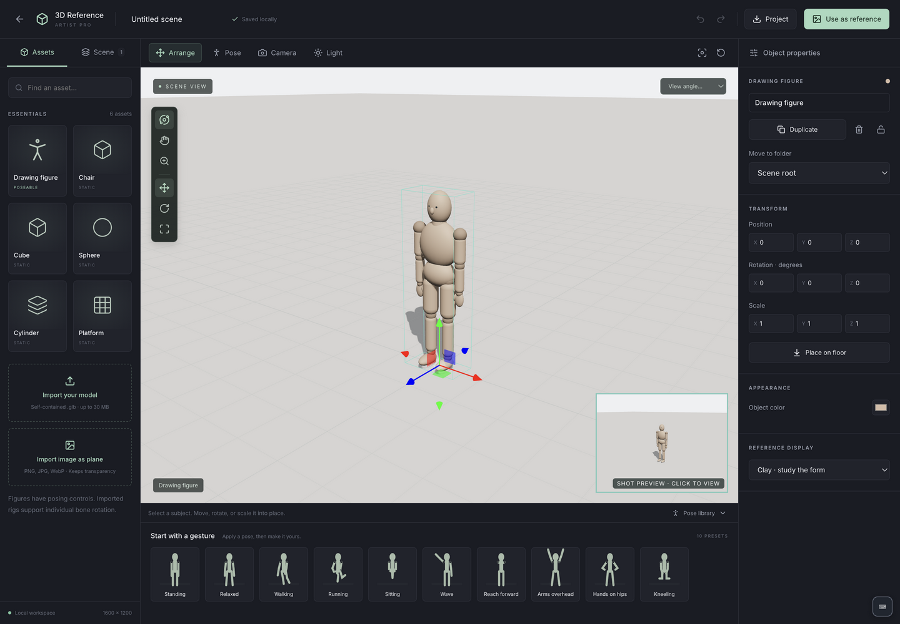

# 3D Reference




Arrange a small 3D scene, pose its subjects, and use the camera image as a 2D drawing reference. Open **3D Reference** from the Artist Studio home screen to create or reopen a scene.

## A first scene

1. Create a scene with the starter drawing figure, or choose an empty scene.
2. Add figures or props from **Assets**. In **Arrange**, move, rotate, or scale the selected object. **Place on floor** lowers it until its lowest visible geometry reaches the ground.
3. Switch to **Pose**. Apply a preset, select a body part, and adjust its rotation. Moving a built-in figure’s hand or foot bends its arm or leg. For a sitting pose, adjust the figure’s height to meet the chair seat.
4. Explore the scene with the orbit, pan, and zoom buttons. Your shot camera stays fixed while you inspect the pose. In **Camera**, choose **Set from current view** when the composition is ready.
5. Choose lighting, floor visibility, and a display style. The camera inset previews the composition.
6. Select **Use as reference** to export a PNG or create a Drawing Canvas project with a locked reference layer and a separate drawing layer.

## What is included

- Multiple articulated drawing figures and static chairs, boxes, spheres, cylinders, and platforms.
- Nested scene folders with shared transforms, inherited visibility and locking, and independent subtree duplication.
- Image planes from PNG, JPEG, and WebP files, with transparency, preserved proportions, and visibility from both sides.
- Ten built-in pose presets, individual joint rotation, built-in hand/foot IK, pose mirroring, and saved custom poses.
- Independent poses for duplicated figures and imported models.
- Perspective and orthographic cameras, camera roll, front/side/top shortcuts, and saved camera views.
- A directional light, ambient fill, light presets, floor shadows, floor/grid controls, and background color.
- Clay, original-material, and silhouette display styles.
- Undo/redo, local autosave, project import/export, PNG export, and Drawing Canvas transfer.

The first version supports basic bone rotation for imported rigs. Automatic humanoid mapping, imported-rig IK, finger posing, foot pinning, collision detection, automatic rigging, animation, cloth simulation, and editable links back from Drawing Canvas are future work. Built-in pose presets and mirroring are available for the built-in drawing figure.

## Scene folders

Open the **Scene** tab and choose **New folder** to create an empty folder. To collect existing objects, Cmd/Ctrl-click their rows, then choose **Group selection**. Folders can contain objects and other folders. Use the arrow beside a folder to collapse or expand its contents in the tree.

Select an object or folder and choose its parent in **Move to folder**, or drag its row onto a folder. Grouping and moving between folders preserve the objects' positions, orientations, and sizes in the scene.

To move an object or nested folder out, drop its row onto the permanent **Scene root** area above the tree, or onto empty tree space. This removes its parent folder while keeping a moved folder's contents together. The row's **Move out of folder** action and the matching inspector button move the item up one level. You can also choose **Scene root** in the **Move to folder** dropdown. All of these actions preserve world transforms and support Undo.

Moving or rotating a folder transforms everything inside it. Folder scaling is uniform, so it keeps the contents' proportions. Child transform values describe their position, rotation, and scale relative to the containing folder.

Hiding a folder hides all its descendants from the viewport and camera exports. Locking a folder prevents edits to its descendants without changing their individual lock settings. A locked object inside a folder also prevents transforming, moving, deleting, or ungrouping that folder until the object is unlocked.

**Duplicate** on a folder copies its entire nested structure with independent object transforms and poses. The copies share embedded image and model assets to avoid storing duplicate file data. **Delete folder and contents** removes the complete subtree; Undo restores it. **Ungroup folder** removes just that folder and moves its direct children into its parent while preserving their world transforms.

Folder membership and transforms are included in local saves and portable project files. Folders count toward the scene's object limit.

## Models and portable projects

**Image planes:** choose **Assets → Import image as plane**, preview the picture, then select **Add to scene**. Move, rotate, scale, duplicate, hide, or lock it like other objects. The Appearance panel provides **Stand upright**, **Lay flat**, and **Restore image proportions**. Pictures retain their original colors in every display mode and are unaffected by lighting. They still sit in 3D space, so nearer objects can cover them.

PNG, JPEG, and WebP files up to **20 MiB** are supported. Images are embedded as PNG, preserving transparency, and resized to at most **2048 pixels** on their longest side. Image planes are included in saved scenes, portable project files, and PNG/Drawing Canvas exports.

**Model import:** self-contained glTF 2.0 binary files (`.glb`), up to **30 MiB per model**. Include geometry and textures inside the file. Models that refer to external files, or require Draco/Meshopt geometry or KTX2 texture compression, are unsupported. Native Blender (`.blend`), FBX, and OBJ imports are not included.

Imported models are centered and normalized to a useful scene size. They can be scaled and rotated after import. Models with a skeleton expose their bones in the Pose panel; static models expose object transforms. The import dialog reports which posing capability is available.

**Project export:** `.reference-3d.json` files store the scene hierarchy, poses, cameras, lighting, embedded images, and GLB assets together. Import these through the scene gallery. An import creates a new project, so importing a copy does not overwrite an existing scene. Identical embedded assets are shared by reference within a saved project.

**Image export:** PNG, from the shot camera, at the document’s output dimensions. Editor grids, selection outlines, and posing handles are excluded. Transparent output removes the background; hide the floor as well when you want only the subjects. Output dimensions range from **64 to 4096 pixels per side**.

Drawing Canvas transfer creates a separate project with a locked **3D reference** image layer at 50% opacity and an empty **Drawing** layer. Adjust the reference layer’s opacity in Drawing Canvas as needed. Later changes to the 3D scene do not automatically refresh this image.

## Saving and limits

Scenes are saved locally in IndexedDB on this device. A save is reported as complete only after its storage transaction commits. Storage failures remain visible in the workspace; download a portable project file to keep a separate copy or move work to another device.

Limits for one scene:

| Resource | Limit |
| --- | --- |
| Scene objects, including folders | 64 |
| Unique imported assets | 24 |
| Embedded image and model data | 64 MiB total |
| Bones per imported model | 512 |
| Saved camera views | 24 |
| Saved custom poses | 64 |

Actual responsiveness depends on model complexity and the device’s graphics hardware. WebGL support is required for the viewport.

## Shortcuts

Press **?** or **Mod + /** to open the keyboard shortcut guide. **Mod** means **⌘ on Mac** or **Ctrl on Windows/Linux**. The guide uses the same shortcut definitions as the workspace controls.

| Action | Shortcut |
| --- | --- |
| Add or remove an object from the scene-tree selection | Mod + click |
| Select all objects | Mod + A |
| Save scene | Mod + S |
| Undo | Mod + Z |
| Redo | Mod + Shift + Z or Mod + Y |
| Duplicate selection | Mod + D |
| Group selection | Mod + G |
| Ungroup folder | Mod + Shift + G |
| Create folder | Shift + N |
| Move out of folder, up one level | Shift + U |
| Arrange / Pose / Camera / Light mode | A / P / C / L |
| Move / rotate / scale selection | G / R / S |
| Orbit / pan / zoom view | O / H / Z |
| Frame selection | F |
| Place on floor | Shift + F |
| Front / side / top view | 1 / 3 / 7 |
| Shot camera view | 0 |
| Show or hide selection | Shift + H |
| Lock or unlock selection | Shift + L |
| Delete selection | Delete or Backspace |
| Clear selection / cancel active transform | Escape |

Shortcuts respect the current selection and its locks. Group multiple selected objects to apply shared actions. When posing a rig, **G** moves eligible built-in hand or foot controls, **R** rotates joints, and **S** is unavailable. Shortcut actions pause while typing, composing text with an input method (IME), using a dialog, or dragging a transform handle. **Escape** remains available to cancel an active transform.

## Development checks

```sh
npx vitest run apps/reference-3d/web
npm run test:reference-3d:browser
npx tsc -b --pretty false
npm run build
```

The browser suite exercises actual Chromium WebGL rendering, GLB skeleton deformation, image-plane colors and transparency, camera independence, PNG alpha and dimensions, autosave during undo, and transfer to Drawing Canvas. Folder checks cover nested transforms and visibility in rendered pixels, inherited locking, subtree duplication/deletion, undo, world-transform preservation when grouping or ungrouping, and reopening saved hierarchies.

The module uses React/TypeScript for the workspace, Three.js for the viewport and model loading, a separate serializable scene document, and IndexedDB for committed local project storage. Project validation checks dimensions, numeric ranges, unique IDs, joint and asset references, GLB containers, embedded resource URLs, and resource limits before saving or importing.

## Suite guides

[Installation](../../docs/installation.md) · [Development](../../docs/development.md) · [Saving and backups](../../docs/data-and-backups.md) · [Testing evidence](../../docs/testing.md) · [Gallery screenshot](../../docs/screenshots/reference-3d/home.png)
