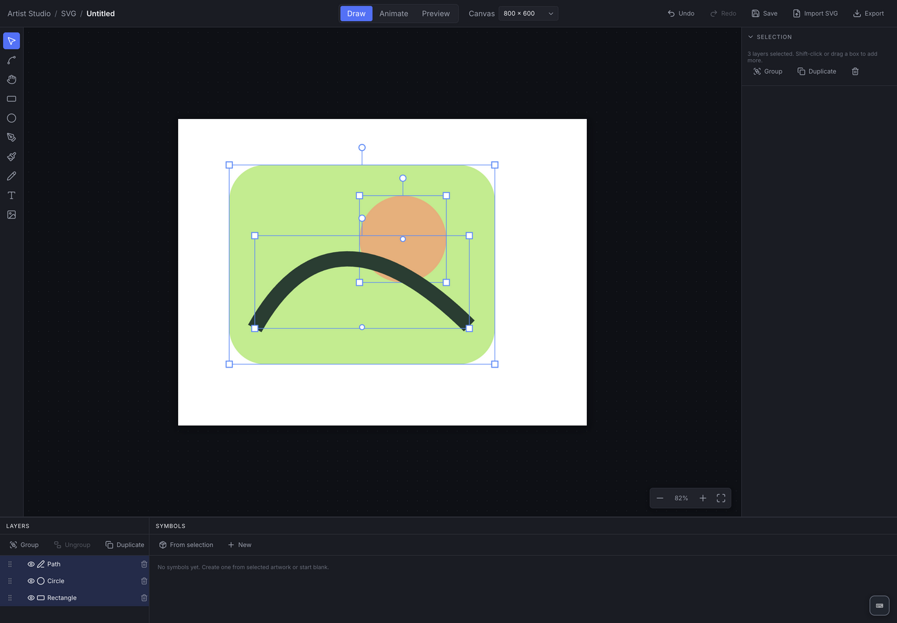

# SVG Studio

Draw and animate vector artwork inside Artist Studio at `#/svg`.



## First project

1. Create a named canvas from the gallery.
2. Draw shapes, paths, freehand strokes, or text; use Import SVG for supported vector artwork.
3. Organize objects in layers/groups, edit transform/paint properties, and turn repeated artwork into reusable symbols.
4. Switch to Animate, move the playhead, and keyframe selected properties. Preview motion and apply animation presets where useful.
5. Use Export for SVG artwork or the render preview for GIF, PNG sequence, and available video formats.

The workspace includes perspective/grid guides, effects, motion paths, undo/redo, and symbol instances. Imported SVG support is a defined subset; inspect the result before relying on output. Raster image content remains raster when embedded in SVG. Browser video codecs and secure contexts affect video availability.

## Saving

Projects and assets are stored through the local API under `/v1/apps/svg-tool`. Desktop starts it automatically; browser sessions need `npm run dev:api`. Exported SVG is artwork rather than a complete copy of every editor-specific animation property. Copy the complete API data directory for editable backups. [Data guide](../../docs/data-and-backups.md).

## Development

`web/model/` owns documents, objects, symbols, effects, SVG import, and animation. `web/store/editorStore.ts` owns editing operations. `web/components/` provides the editor, inspector, timeline, layers, and rendering UI. `web/render/` generates SVG frames and encoded output. `server/` stores local projects/assets.

```sh
npx vitest run apps/svg-tool
npm run test:suite:browser
npm run build
```

[Gallery screenshot](../../docs/screenshots/svg-tool/home.png) · [Setup](../../docs/development.md) · [Testing](../../docs/testing.md) · [Shortcuts](../../docs/keyboard-shortcuts.md)
